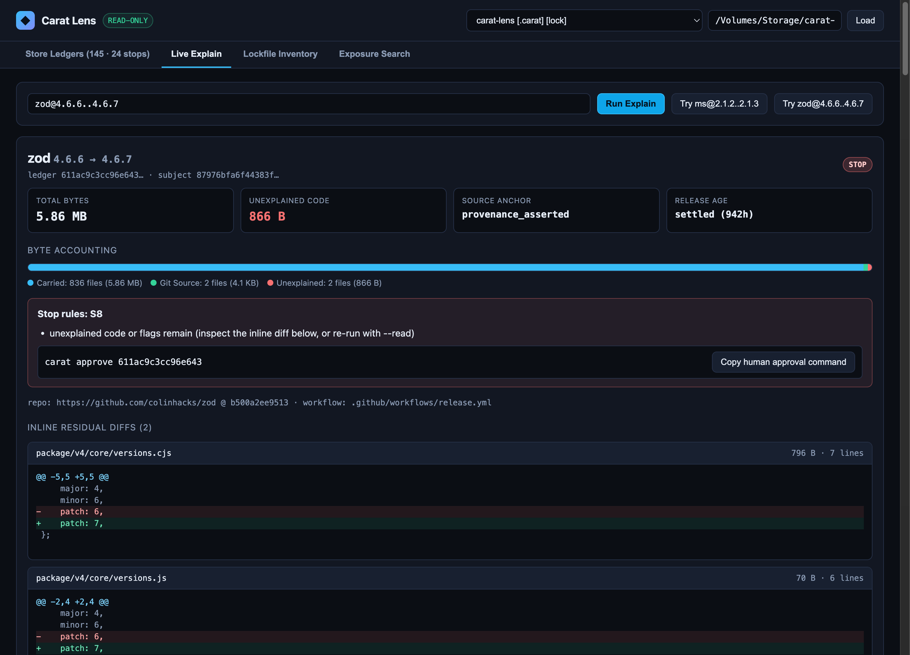
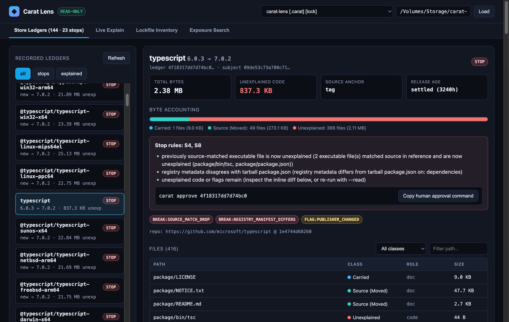
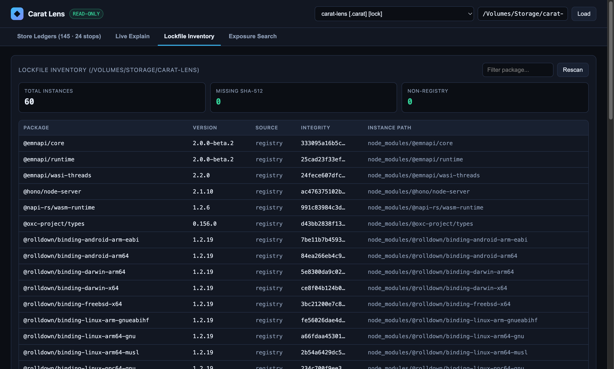

# Carat Lens

A local, strictly read-only visual **Dependency Balance Sheet** dashboard for [Carat](https://github.com/steph4n-gh/carat).

Built end-to-end with Carat as the sole installer (`carat add` / `carat add -D`, zero raw `npm install`) and gated by `.github/workflows/carat-pr.yml`.



## Views

### 1. Live Explain (`carat explain`)
Run any `<pkg>@<from>..<to>` registry transition on demand and inspect byte accounting, provenance anchor metadata, stop rules, and syntax-highlighted inline residual diffs without extracting untrusted tarballs to disk.

### 2. Store Ledgers (`.carat/`)
Inspect recorded transition ledgers, decisions, and human approvals in a repository's `.carat/` store—deduplicated to the latest ledger per `subject` (with a full-history toggle), subject-matched approval validation (S10 fact superset check), break/flag/reach badges, filterable file-origin tables, and a **read-only Batch Approve Command Builder** that lets you check unapproved stops to copy a single `carat approve <id1> <id2> ...` command.



### 3. Git Diff (`carat check`)
Compare `package-lock.json` across any two Git commits or branches directly in the browser (pre-populated from `git log -- package-lock.json`), showing gate pass/stop status, shortest introducer routes, and inline residual diffs.

### 4. Lockfile Inventory (`carat inventory`)
Audit standing lockfile health (`package-lock.json` v3): total package instances, missing SHA-512 integrity hashes, non-registry sources, and searchable package paths.



### 5. Exposure Search (`carat exposure`)
Trace historical admission windows for any `<name>@<version>` across Git lockfile history and the local `.carat/` store.

---

## Security Boundary
- Binds strictly to `127.0.0.1:4177`.
- Executes `carat` via `execFile` (never a shell) with strict Zod input validation on every API boundary.
- **Strictly read-only:** never runs `carat approve`, never edits `carat.toml`, and never installs packages.

## Running Locally

Prerequisites: Node 22+ (native TypeScript execution) and `carat` on your `PATH` (`cargo install carat`).

```bash
# Production build (single port: http://127.0.0.1:4177)
npm run build
npm start

# Development (API on :4177 + Vite HMR on :5177)
npm run dev:server
npm run dev

# Integration tests (node:test against real Carat CLI & local .carat store)
npm test
```

Point `carat-lens` at any project by setting `CARAT_LENS_DIR=/path/to/repo`, typing a path in the top bar, or picking a sibling repository from the auto-discovered project dropdown.
